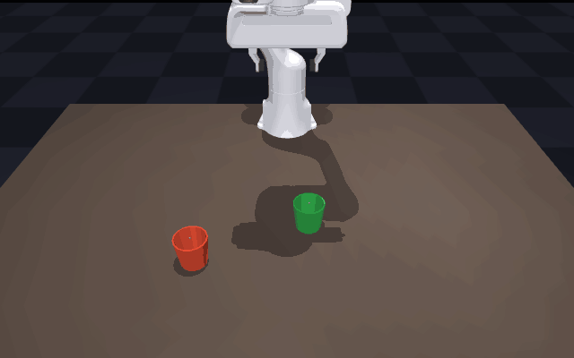
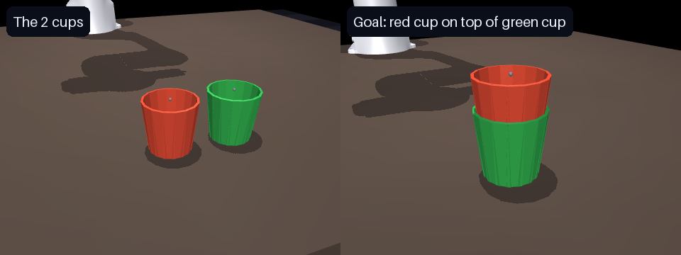
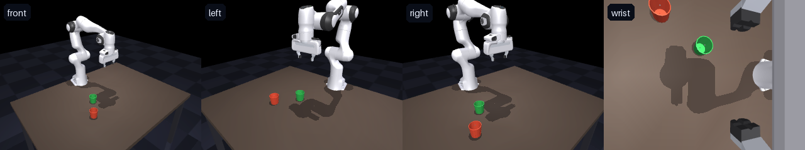
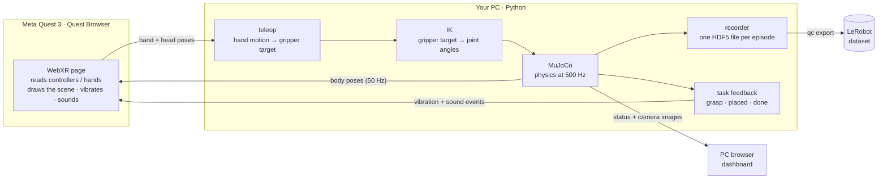

# QuestCollect

**Control a simulated robot arm with a Meta Quest 3, put one cup on another, and record every attempt as training data for
robot learning.**


[](LICENSE)

<p align="center">
  
  <br><sub>A Franka Panda arm stacks the cups. This clip is scripted by
  <a href="scripts/make_media.py">scripts/make_media.py</a>, using the same IK, gripper and physics as the headset.</sub>
</p>

To teach a robot a task by imitation, you need many examples of a person doing that task *with the robot*.
QuestCollect produces those examples in simulation:

1. A **Franka Panda** arm stands at a table in the **[MuJoCo](https://mujoco.org)** physics simulator on your PC.
2. You put on a **Meta Quest 3** and open a web page. You see the table and the arm in VR (or mixed reality) and
   move it with the right **Touch controller** or your right **bare hand**.
3. Every attempt is saved as one **episode** file, with the complete simulator state at every step.
4. One command turns the episodes into a **[LeRobot](https://github.com/huggingface/lerobot) dataset** that
   training code for ACT, Diffusion Policy, π0 or SmolVLA reads directly.

Nothing is installed on the headset: the PC serves a web page and the Quest Browser opens it.

<table>
  <tr>
    <td width="50%"></td>
    <td width="50%"></td>
  </tr>
  <tr>
    <td align="center"><sub><b>In the headset:</b> goal panel, status panel, and your controllers with a label on every button</sub></td>
    <td align="center"><sub><b>On the PC:</b> live 3D view, the recorded cameras, the goal, the recorder and the saved episodes</sub></td>
  </tr>
</table>

## Contents

- [Quick start](#quick-start)
- [The task: stack the cups](#the-task-stack-the-cups)
- [Installation](#installation)
- [Usage](#usage):
  [1. Start the server](#1-start-the-server) ·
  [2. Connect the Quest](#2-connect-the-quest-3) ·
  [3. Controls](#3-controls) ·
  [4. Record](#4-record-demonstrations) ·
  [5. Export](#5-export-for-training)
- [What gets recorded](#what-gets-recorded)
- [How it works](#how-it-works)
- [Repository layout](#repository-layout)
- [Configuration](#configuration)
- [Troubleshooting](#troubleshooting)
- [Development](#development)
- [Acknowledgements](#acknowledgements) · [License](#license)

## Quick start

On Linux, with [uv](https://docs.astral.sh/uv/), Node.js ≥ 20 and git installed, and **`mujoco_toy-project`
checked out next to this repository** (the robot and the cups are imported from its `models/` folder):

```bash
git clone https://github.com/HarunSMetin/MetaQuest3DataCollection.git
cd MetaQuest3DataCollection                # ../mujoco_toy-project must exist (or set QC_TOY_PROJECT)
uv sync                                   # create the Python environment
(cd web && npm ci && npm run build)       # build the headset page and the dashboard
uv run qc serve                           # start, then open http://localhost:8000/dashboard/
```

You don't need a headset for a first look: the dashboard shows the live scene and the cameras, and
`uv run qc view` opens the scene in MuJoCo's own viewer. When you're ready, [connect the Quest](#2-connect-the-quest-3).

## The task: stack the cups

<p align="center"></p>

The scene is **`mujoco_toy-project`'s `models/panda_scene.xml`**, imported as it is: the Panda and two tapered
cups, a 🟩 **green** one and a 🟥 **red** one (the toy's `cup_green.xml` / `cup_red.xml`). Only where the cups start
on the table changes per episode. Your job: **put the red cup on top of the green cup**, wherever the green cup
is. There is no target area on the table.

**When does it count as done?** Both cups stand upright, the red cup rests centred (within 1 cm) inside the green
one, the gripper has let go, and both are standing still. Recording then stops on its own one second later.

The **goal panel** (in the headset and on the dashboard) shows the target, *0 / 1* until the red cup is in the green
one, then *1 / 1*.

### What is simulated, and how closely

| | |
| --- | --- |
| **Cup shape** | 7 cm tall, 5.6 cm across at the bottom and 7.2 cm at the rim, 3 mm walls, about 35 g. MuJoCo only collides convex shapes, so each cup is a thin disc plus a ring of 16 thin tilted boxes; nested cups rest about 33 mm above each other. |
| **Stiffness** | Contacts are stiff: an arm pressing on a cup or the table doesn't sink in. |
| **Gripper** | Like the real Franka Hand: the fingers move at 50 mm/s and squeeze with a set force (40 N by default; the real hand does up to 70 N), whatever the cup's width. |
| **Collisions** | The arm collides with the table and the cups. A blocked arm stops; it doesn't push through, and it doesn't jump when it comes free. |

## Installation

### Requirements

| | Needed for |
| --- | --- |
| **Linux** (developed on Ubuntu) | everything. A GPU with EGL drivers is recommended for the camera images. |
| **[uv](https://docs.astral.sh/uv/)** | the Python environment. It installs Python 3.12 for you. |
| **Node.js ≥ 20** | building the web pages (once, and after changes to `web/`). |
| **git** | downloading the robot model. |
| **Meta Quest 3** | teleoperation. Optional for a first look. |
| **adb** (`sudo apt install android-tools-adb`) | the USB connection to the headset. |
| **openssl** (usually preinstalled) | the Wi-Fi connection only. |

<details>
<summary>Installing uv and Node.js</summary>

```bash
curl -LsSf https://astral.sh/uv/install.sh | sh                                                    # uv
curl -o- https://raw.githubusercontent.com/nvm-sh/nvm/v0.40.1/install.sh | bash && nvm install 22    # Node.js via nvm
```

</details>

### Steps

```bash
git clone https://github.com/HarunSMetin/MetaQuest3DataCollection.git
cd MetaQuest3DataCollection            # 1. next to your mujoco_toy-project checkout

uv sync                                # 2. Python environment (.venv/)
(cd web && npm ci && npm run build)    # 3. headset page + dashboard -> web/dist/
uv run qc doctor                       # 4. check that everything is in place
```

The scene (`models/panda_scene.xml`: MuJoCo Menagerie's Panda with the toy project's TCP site and wrist camera,
the green and red cup, and a `front` camera) is loaded from **`../mujoco_toy-project`** and set on a table. If your checkout is
somewhere else, set `QC_TOY_PROJECT=/path/to/mujoco_toy-project`. Changes to those model files show up here
the next time you start `qc serve`.

`qc doctor` prints a ✓/✗ checklist with a hint next to anything missing. The first four items (toy-project models,
scene, rendering, web build) are all you need to start; adb, the headset and the certificate only matter for
connecting the Quest.

## Usage

Everything goes through the `qc` command (run it as `uv run qc …`; every command has `--help`):

| Command | What it does |
| --- | --- |
| `qc serve` | start the simulator, the web pages and the recorder |
| `qc setup-quest` | connect a headset plugged in over USB |
| `qc certs` | create a certificate for connecting over Wi-Fi |
| `qc view` | open the scene in MuJoCo's own viewer (no headset) |
| `qc inspect <file>` | show what is inside an episode file |
| `qc replay <file>` | play an episode back in MuJoCo's viewer |
| `qc export` | turn the episodes into a LeRobot dataset |
| `qc doctor` | check the installation |

### 1. Start the server

```bash
uv run qc serve                     # options: --mode hands · --config my.yaml · --no-https
```

Keep this terminal open and open **<http://localhost:8000/dashboard/>** on the PC. You should see the arm, the
cups, three camera images and the recorder. The terminal prints the addresses for the headset.

### 2. Connect the Quest 3

The Quest Browser only allows VR on `http://localhost` or on `https://` pages, so connect in one of two ways.

#### USB cable (recommended: lowest latency, no certificate)

1. *First time only:* in the Meta Horizon phone app, open your headset's settings and turn on **Developer Mode**.
2. Plug the headset into the PC, put it on and accept **Allow USB debugging**.
3. In a second terminal, run `uv run qc setup-quest`. This makes the headset's `localhost:8000` reach the PC.
4. In the **Quest Browser**, open `http://localhost:8000/xr/` and press **Enter VR** (or **Enter Mixed Reality**).

Run `qc setup-quest` again after you replug the cable or restart the headset.

#### Wi-Fi

```bash
uv run qc certs     # once: a self-signed certificate for this PC's network address (saved in certs/)
uv run qc serve     # restart: it now also serves https on port 8443
```

Open the `https://<pc-ip>:8443/xr/` address the server prints, and accept the certificate warning once
(Advanced → Proceed). Use 5 or 6 GHz Wi-Fi, ideally with the PC on a cable.

**Hand tracking** needs Settings → Movement tracking → **Hand and body tracking** turned on in the headset.

<p align="center"><br>
<sub>The start page in the Quest Browser. Pick controllers or hands, then enter VR.</sub></p>

### 3. Controls

When you enter VR, the table is placed in front of you automatically. The arm follows your **right hand**
(pink); the left controller only has the buttons for saving, the menu and recentering. The arm moves only while you
have *taken control* of it, like a mouse that only moves the cursor while it's on the desk: take control, move, let
go, move your hand somewhere comfortable, take control again, and the arm carries on from where it was.

| Action | Controllers | Hands |
| --- | --- | --- |
| Take / give up control of the arm | press right **Grip** (toggles) | pinch right **thumb + middle finger** (toggles) |
| Close / open the gripper | right **Trigger** (how far you pull = how far it closes) | distance between right **thumb and index finger** |
| Start / stop recording | **A** | wrist menu |
| Save the take | **X** | wrist menu |
| Throw the take away | **B** | wrist menu |
| Open the wrist menu | **Y** | turn your **left palm** towards your face |
| Re-place the table in front of you | **left stick click** | wrist menu |

**What you see in the headset:**

- **Your controllers**, with a label next to every button saying what it does right now. A label lights up while
  you press it and dims when the action isn't available (e.g. *Save* before anything was recorded). A tag above
  each controller shows whether it controls the arm, which cup it holds, *Out of reach* and *REC*. The right
  controller glows in the arm's colour while it controls the arm.
- **The grasp point**: a small dot between the gripper's fingers, with a line down to the table to help you line
  up a cup. It turns **red** when the arm can't reach where you're pointing; move back towards the robot.
- **The status panel** above the far table edge: recorder state, the task, latency and input rate.
- **The goal panel** to its left: the target stack and your progress.
- **The wrist menu** (below): input mode; record, save as success, save as failure, discard; recenter; motion
  scale (*Slower* / *Faster*); new scene; exit VR; sound on/off; button labels on/off.

<p align="center"></p>

**Vibration and sound.** Every event has its own vibration pattern and sound, so you can tell what happened
without looking. Sounds come from the side of the arm (the right).

| What happened | You feel | You hear |
| --- | --- | --- |
| You took / gave up control of the arm | a pulse / a softer pulse | a rising / falling blip |
| The gripper closed on a cup | one short pulse | a low *tock* |
| You are holding a cup | a faint tick, 4 times a second | — |
| You let go | a soft blip | a short tick |
| A cup came to rest in its spot on the stack | a strong **double** pulse | a two-note chime |
| The stack is finished and standing | a long **triple** pulse | a rising arpeggio |
| The arm touched the table | a short buzz | a thump |
| The arm can't reach where you're pointing | a short buzz | a double beep |

Vibration needs the controllers. Sound starts when you press *Enter VR* and can be muted in the wrist menu.

### 4. Record demonstrations

Each take goes through these stages:

```text
ready ──A──▶ 3 s countdown ──▶ recording ──A (or 1 s after success)──▶ review ──X──▶ saved
                                                                          └──B──▶ discarded
```

After you save or discard, the two cups start in new random places. **X** marks the take as a success if
the stack was finished at some point during it; on the dashboard and in the wrist menu you can also save a take
explicitly as a *success* or a *failure*.

**On the dashboard:** `Space` record / stop · `S` save as success · `F` save as failure · `D` discard ·
`R` new scene · `C` recenter. Set the operator name in the Recorder card; it is stored in every episode.

**Tips for good demonstrations:**

- Grab cups from above, just below the rim: lower down, the fingers hit the rim of the cup below when you nest them.
- Hold the red cup centred over the green one and lower it until it is about a centimetre above its resting place,
  then open the gripper and let it drop in. The double pulse tells you it is in its spot.
- Do it the same way every time (similar grasps and motions), so the dataset is consistent.

Episodes are saved as `data/episodes/episode_000000.hdf5`, `episode_000001.hdf5`, … (about 6 MB per minute).
Check or replay one:

```bash
uv run qc inspect data/episodes/episode_000000.hdf5   # metadata and the shape of every field
uv run qc replay  data/episodes/episode_000000.hdf5   # play it back in MuJoCo's viewer (--speed 2 for faster)
```

The dashboard's **Dataset** card lists all episodes: ▶ replays one in the scene (also shown in the headset), 🗑
deletes it.

### 5. Export for training

```bash
uv sync --extra export     # once: installs LeRobot
uv run qc export           # data/episodes -> data/lerobot
```

| Option | Default | Meaning |
| --- | --- | --- |
| `--action joint\|ee` | `joint` | state and action as joint angles, or as gripper poses |
| `--height`, `--width` | 480, 640 | camera image size (images are rendered during export, at any size) |
| `--include-failures` | off | also export takes saved as failures |
| `--randomize-visuals` | off | vary lighting, colours and camera mounts per episode (helps vision policies transfer to real cameras) |
| `--out` | `data/lerobot` | output folder |
| `--raw` | `record.out_dir` | episode folder to read |
| `--repo-id` | `local/quest_panda_cups` | dataset name |

## What gets recorded

One HDF5 file per episode, one row per control step (**50 per second**). The authoritative field list is the
docstring at the top of [questcollect/recorder.py](questcollect/recorder.py).

| Field | Shape | Contents |
| --- | --- | --- |
| `obs/joint_pos`, `obs/joint_vel` | (T, 7) | joint angles and velocities |
| `obs/gripper_width` | (T, 1) | finger opening in metres (0 to 0.08) |
| `obs/ee_pose` | (T, 7) | gripper pose: position + quaternion (w x y z), world frame |
| `obs/objects` | (T, 2, 7) | the green and red cup poses (centre of each cup's bottom) |
| `action/joint_pos` | (T, 8) | **[7 joints, gripper]**; gripper 0 = closed, 1 = open |
| `action/ee_pose` | (T, 8) | where the gripper was sent: pose, gripper value |
| `sim/state` | (T, 217) | the complete simulator state before each step |
| `success` | (T,) | whether the stack is finished and standing |
| `progress` | (T,) | 1 while the red cup sits in the green one, else 0 |
| `teleop/*` | | head pose; per hand (both, also the one without an arm) the raw controller pose and buttons or 25 hand-joint poses, pinch distances; engaged / tracked flags of the arm; latency |
| `time`, `wall_time` | (T,) | simulation time and PC clock |
| *file attributes* | | task, instruction, operator, input mode, success, random seed, date, duration, the full scene (MJCF), the config, camera names, and the cup definition |

**Camera images are not stored while recording.** Because the complete simulator state is saved, the exporter
replays every step exactly and renders the cameras afterwards, at whatever resolution you choose. Recording stays
light, and you can re-export with other image sizes without recording again. The cameras: `front` and `wrist`
(on the hand, looking along the fingers) come with the toy scene; `left` and `right` (front-left and front-right of
the workspace) are added here:

<p align="center"></p>

**The LeRobot dataset** contains:

| Feature | Shape | Contents |
| --- | --- | --- |
| `observation.state` | (8,) | joint angles + gripper opening (or gripper pose with `--action ee`) |
| `action` | (8,) | `action/joint_pos` (or `action/ee_pose`) |
| `observation.images.<camera>` | (H, W, 3) | one video per camera, re-rendered from `sim/state` |
| `observation.environment_state` | (14,) | the two cup poses (simulation only; a real robot doesn't have these) |
| `task` | text | the instruction, used as the language prompt |

## How it works



- **The simulation runs only on the PC**, in one 50 Hz loop: read the latest hand poses, turn them into gripper
  targets, solve inverse kinematics for the arm, step the physics, record. The headset only sends what it
  tracks and draws what the PC sends back, so the robot you see is exactly the robot that gets recorded.
- **Hand motion is relative.** While you control the arm, its gripper moves by as much as your hand has moved
  (times the motion scale) since you took control. Your hand motion is smoothed, and a tracking glitch (a jump of
  more than 12 cm, or no data for 0.25 s) releases the arm until you take control again. Targets outside the
  reachable workspace box are clamped.
- **Everything the browser shows comes from the server.** The headset and the dashboard rebuild the 3D scene
  from geometry the server exports, and draw the goal from the task description it publishes, so changing the
  scene or the stack in Python needs no changes in the browser code.

The full picture (threads, the 50 Hz tick step by step, the wire protocol, coordinate frames, the IK, the cup
task, and which files change together) is in **[docs/architecture.md](docs/architecture.md)**.

## Repository layout

```text
questcollect/              the Python package, one module per stage of the pipeline
  cli.py                   the `qc` command (serve, setup-quest, certs, view, inspect, replay, export, doctor)
  config.py                loads config.yaml into typed settings
  sim.py                   the MuJoCo scene, the cups, the stack task (progress, success), the environment
  frames.py                converts poses between the headset's coordinates and the simulator's
  teleop.py                hand / controller motion → gripper targets (clutch, smoothing, safety checks)
  ik.py                    gripper target → joint angles (inverse kinematics with mink)
  runtime.py               the 50 Hz loop: input → teleop → IK → physics → record, plus vibration and sound events
  recorder.py              record / save / discard logic and the HDF5 episode format
  server.py                web server: the pages, the REST API, websockets to the headset and the dashboard
  protocol.py              binary message format between headset and server (mirrored in web/src/protocol.ts)
  scene_export.py          sends the scene's shapes and meshes to the browser so it can draw them
  lerobot_export.py        episode files → LeRobot dataset (re-renders the cameras)
web/                       the browser side (TypeScript, three.js, React), built into web/dist/
  xr/index.html            the headset page    → code in src/xr/        (WebXR app, panels, controllers, sounds)
  dashboard/index.html     the PC dashboard    → code in src/dashboard/ (React)
  src/MujocoScene.ts       draws the MuJoCo scene with three.js (used by both pages)
  src/goal.ts              draws the goal stack (used by both pages)
  src/protocol.ts, net.ts  message formats and the websocket connection
  public/xr-profiles/      Quest 3 Touch Plus controller models (vendored, MIT)
  e2e/                     tests with an emulated Quest 3, and the README screenshots
tests/                     Python tests: teleop and protocol; cup stacking, gripper, IK, recording, export
scripts/
  make_media.py            renders docs/media/demo.gif, cups.png, cameras.png
docs/
  architecture.md          how the code works, for developers
  media/                   the images and the GIF in this README
config.yaml                all runtime settings
```

Created when you run things (all gitignored): `.venv/`, `web/node_modules/`,
`web/dist/`, `certs/` (Wi-Fi certificate), `data/episodes/` (your recordings), `data/lerobot/` (exports).

## Configuration

Runtime settings live in [config.yaml](config.yaml). Use another file with `uv run qc serve --config my.yaml`.

| Setting | Default | Meaning |
| --- | --- | --- |
| `sim.physics_dt` | 0.002 | physics step (500 Hz) |
| `sim.control_hz` | 50 | control and recording rate |
| `sim.table_height` | 0.75 | table height (m) |
| `sim.gripper_force` | 40 | squeeze force on a grasped object (N; the real Franka Hand does up to 70) |
| `teleop.mode` | `controllers` | `controllers` or `hands` (also switchable in the headset and on the dashboard) |
| `teleop.scale` | 1.0 | hand motion → gripper motion (the wrist menu's *Slower* / *Faster*) |
| `teleop.pinch_open_m`, `pinch_closed_m` | 0.08, 0.015 | thumb–index distances for a fully open / closed gripper in hand mode (m) |
| `teleop.filter_min_cutoff`, `filter_beta` | 1.5, 0.5 | smoothing (One-Euro filter): lower cutoff = smoother, higher beta = less lag in fast moves |
| `teleop.workspace_min`, `workspace_max` | | the box the grippers are kept in (world frame, m) |
| `ik.position_cost`, `orientation_cost`, `posture_cost` | 1.0, 0.6, 0.01 | IK weights |
| `ik.max_joint_vel` | 2.5 | joint speed limit (rad/s) |
| `ik.max_lead` | 0.15 | how far (rad) the IK may run ahead of a blocked arm |
| `ik.iterations` | 2 | IK solver iterations per control step |
| `record.out_dir` | `data/episodes` | where episodes are saved |
| `record.countdown_s` | 3 | countdown before recording starts (s) |
| `record.cameras` | the four cameras | cameras shown on the dashboard and exported |
| `record.operator` | `operator` | default operator name stored in episodes |
| `server.host`, `port`, `https_port`, `cert_dir` | 0.0.0.0, 8000, 8443, `certs` | network address, ports and certificate folder |

**The task** is defined by constants at the top of [questcollect/sim.py](questcollect/sim.py): the cups
(`CUPS`: order and colour), their shape (`CUP_R_BOTTOM`, `CUP_R_TOP`, `CUP_H`, `CUP_T`, `CUP_DENSITY`) and the stacking tolerances (`TOL_*`, `NEST_DZ_RANGE`). The goal
panels follow these automatically. The arm follows the right controller (`ARMS`). The vibration patterns are the
`HAPTIC_*` constants in [questcollect/runtime.py](questcollect/runtime.py); the sounds are in
[web/src/xr/sounds.ts](web/src/xr/sounds.ts).

## Troubleshooting

| Problem | Fix |
| --- | --- |
| **Enter VR** is greyed out | You are not in the Quest Browser, or the address is not `http://localhost` / `https://`. Run `qc setup-quest` again after replugging. |
| `qc setup-quest` says *no device* or *unauthorized* | Turn on Developer Mode, put the headset on and accept the USB debugging prompt. |
| No camera images, or `qc doctor` fails at rendering | Check the NVIDIA EGL drivers, or try `MUJOCO_GL=osmesa uv run qc serve`. |
| The page says *Web client not built* | `cd web && npm ci && npm run build` |
| The arm doesn't move | Take control with the right **Grip** (after a tracking glitch the arm is released). The left controller has no arm. Look for *Pick up controllers* / *Put controllers down* (the input mode doesn't match what you're holding) or *Out of reach*. |
| The grasp-point dot is red | The arm can't get there: too far from its base (more than ~0.8 m), right in front of its own base, or the wrist is twisted to its limit. Move back towards the robot or turn your wrist back. |
| No vibration | Vibration needs the controllers; with hand tracking there is nothing to vibrate. |
| No sound | Sound starts when you press **Enter VR** (browsers block audio before a click). Check **Sound** in the wrist menu and the headset volume. |
| The red cup is on the green one but it doesn't count | Both cups must be upright, red must be inside green (not the other way round) and centred within 1 cm, and you must let go. |
| A cup slips in the gripper | Raise `sim.gripper_force` in `config.yaml`. |
| Laggy over Wi-Fi | Use the USB cable, or move closer to a 5/6 GHz access point. |
| `EGLError` printed when a command exits | Harmless: MuJoCo's GL context is cleaned up after Python has shut down. |

## Development

```bash
uv run --group dev pytest                    # Python tests (~10 s)
MUJOCO_GL=egl uv run --group dev pytest      # + the LeRobot export test (needs `uv sync --extra export`)
cd web && npm run typecheck                  # TypeScript
cd web && npm run dev                        # pages with hot reload on :5173 (proxies to a running `qc serve`)
```

**Testing without a headset.** Open `/xr/` in desktop Chrome with Meta's
[Immersive Web Emulator](https://chromewebstore.google.com/detail/immersive-web-emulator/cgffilbpcibhmcfbgggfhfolhkfbhmik)
extension, or run the automated test [web/e2e/emulated-quest.mjs](web/e2e/emulated-quest.mjs): it drives an
emulated Quest 3 in a headless browser against a running server and checks controllers, hand tracking, the clutch,
the gripper and the record → save flow. Setup is at the top of the file. Point that server at a scratch
`record.out_dir`, because the test saves a few episodes.

**Regenerating the README media:**

```bash
MUJOCO_GL=egl uv run python scripts/make_media.py   # demo.gif, cups.png, cameras.png (must print success: True)
cd web/e2e && npm run screenshots                   # dashboard.png, xr_landing.png, xr_headset.png, xr_menu.png
                                                    # (needs `uv run qc serve --no-https` running)
```

Before changing the code, read [docs/architecture.md](docs/architecture.md): it explains the threads, the wire
protocol, and which files have to change together.

## Acknowledgements

- Franka Emika Panda model from [MuJoCo Menagerie](https://github.com/google-deepmind/mujoco_menagerie)
  (Apache-2.0), loaded from mujoco_toy-project's copy; not included in this repository.
- Quest 3 Touch Plus controller models from [WebXR Input Profiles](https://github.com/immersive-web/webxr-input-profiles)
  (MIT), in `web/public/xr-profiles/`.
- [MuJoCo](https://mujoco.org) for physics, [mink](https://github.com/kevinzakka/mink) for inverse kinematics,
  [three.js](https://threejs.org/) for rendering, [LeRobot](https://github.com/huggingface/lerobot) for the dataset
  format, and Meta's [IWER](https://github.com/meta-quest/immersive-web-emulation-runtime) for headset-free testing.
- The scene (robot, cups, front camera) is imported from `mujoco_toy-project` (`models/panda_scene.xml`).
- Franka Hand speed and force from its published specifications.

## License

QuestCollect is released under the [MIT License](LICENSE). Third-party parts keep their own licenses: the Franka
Panda model (Apache-2.0, downloaded separately) and the controller models in `web/public/xr-profiles/` (MIT).
