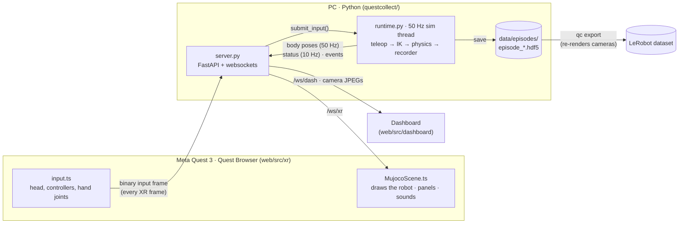

# How QuestCollect works

This is the developer guide: what each part of the code does, how data moves through it, and where to change
things. For installing and using QuestCollect, see the [README](../README.md).

- [The big picture](#the-big-picture)
- [One control tick](#one-control-tick)
- [Threads and who owns what](#threads-and-who-owns-what)
- [Network: endpoints and the wire protocol](#network-endpoints-and-the-wire-protocol)
- [Coordinate frames](#coordinate-frames)
- [Teleoperation: from hand to arm target](#teleoperation-from-hand-to-arm-target)
- [Inverse kinematics](#inverse-kinematics)
- [The scene and the task](#the-scene-and-the-task)
- [Recording, replay and export](#recording-replay-and-export)
- [The web client](#the-web-client)
- [Common changes](#common-changes)
- [Tests](#tests)

## The big picture



The simulation exists only on the PC. The headset sends what it tracks (head, controllers or hands) and draws
the body poses the PC sends back, so the robot the operator sees is the same robot that is recorded. The
headset and the dashboard both rebuild the 3D scene from geometry the server exports (`/api/scene`), so nothing
about the robot or the cups is hard-coded in the browser.

## One control tick

`Runtime._tick` runs 50 times a second (`sim.control_hz`). Each tick, in order:

| Step | Code | What happens |
| --- | --- | --- |
| 1 | `Runtime._process_commands` | Apply queued commands (record, save, reset, set mode, …) from the dashboard, the headset menu or the buttons. |
| 2 | `Teleop.update` | Latest input frame → one end-effector target and one gripper value per arm in `sim.ARMS` (just the right one), plus button commands from both controllers (see [Teleoperation](#teleoperation-from-hand-to-arm-target)). |
| 3 | `ArmIK.follow` + `solve` | Target → 7 joint angles, with the IK held within `ik.max_lead` of the measured joints. |
| 4 | `Recorder.tick` | Advance the countdown; switch to recording when it ends. |
| 5 | `PandaEnv.observe` / `get_state` | If recording: snapshot the observation and the full sim state *before* the step. |
| 6 | `PandaEnv.apply_action` | Joint targets to the arm servos; the gripper target moves at 50 mm/s per finger. |
| 7 | `Recorder.append` | If recording: store the step (obs, action, state, success, progress, raw teleop). |
| 8 | `PandaEnv.step` | 10 physics substeps (`physics_dt` = 2 ms). |
| 9 | `Runtime._task_feedback` | Compare grasp / progress state with the last tick and emit haptic, sound and toast events. |
| 10 | `Runtime._check_warnings` | Arm–table contacts, out-of-reach targets. |
| 11 | `Runtime._publish` | Pack the pose frame; every 5th tick the status dict; every 6th tick camera previews (only while someone is looking). |

During a replay (`replay` command or `qc replay`), steps 2–10 are skipped: the tick just loads the next recorded
state with `PandaEnv.set_state`.

## Threads and who owns what

| Thread | Owns | Talks to the others through |
| --- | --- | --- |
| **sim** (`Runtime._run`) | the MuJoCo model and data, IK, teleop, recorder | — |
| **asyncio** (uvicorn, `server.py`) | websockets, HTTP | `Runtime.submit_input`, `command`, `latest_pose_frame`, `status`, `previews` (all lock-protected), and events pushed through `Runtime.add_listener` → `Hub` |
| **hdf5-writer** (`Recorder`) | writing one finished episode | a single-worker `ThreadPoolExecutor`, so saving never stalls the 50 Hz loop |

Rule: the server never touches simulation state directly. Anything that changes the sim goes through
`Runtime.command(name, **args)`, which queues it for step 1 of the next tick.

## Network: endpoints and the wire protocol

| Endpoint | Direction | Content |
| --- | --- | --- |
| `GET /xr/`, `/dashboard/` | → browser | the built web pages (`web/dist`) |
| `GET /api/scene`, `/api/scene.bin` | → browser | visual geometry: bodies, geoms, materials (JSON) + mesh vertices/faces (binary) |
| `GET /api/task` | → browser | the goal as data: cup shape, cups, where each goes (`sim.task_spec()`) |
| `GET /api/status` | → browser | the latest status dict (same as on the websockets) |
| `GET /api/episodes`, `DELETE /api/episodes?path=` | ↔ | list / delete saved episodes |
| `POST /api/command` | → server | `{"name": ..., "args": {...}}`, queued to the sim thread |
| `GET /api/preview/<cam>.jpg` | → browser | latest camera preview (rendered only while requested) |
| `WS /ws/xr` | both | headset: binary input frames in; binary pose frames (every tick), JSON status + events out |
| `WS /ws/dash` | both | dashboard: pose frames at 30 Hz, JSON status + events out; JSON commands in |

**Binary frames** are defined in [questcollect/protocol.py](../questcollect/protocol.py) and mirrored by hand
in [web/src/protocol.ts](../web/src/protocol.ts) (little endian, 16-byte headers):

- *Input* (headset → server, every XR frame): header with both hands' input source (none / controller / hand),
  sequence number and an echoed server timestamp (for the round-trip time), then the head pose and, per hand, the
  control pose, 8 button values, 25 hand-joint poses and 2 pinch distances: always 391 floats (1,580 bytes).
- *Pose* (server → clients): header with flags (left engaged, right engaged, recording; only the arms in `sim.ARMS` are ever engaged), body count and server
  time, then every MuJoCo body's world pose.

**JSON events** (server → clients): `status` (10 Hz), `toast`, `haptic` (`arm`, `intensity`, `ms`, `repeat`,
`gap_ms`), `sound` (`name`, `arm`), `saved`.

## Coordinate frames

[questcollect/frames.py](../questcollect/frames.py) converts between the two worlds:

| | Up | Forward | Quaternion order |
| --- | --- | --- | --- |
| WebXR `local-floor` | +y | −z | x y z w |
| MuJoCo world | +z | +x (away from the operator) | w x y z |

`Placement` is the rigid transform that puts the simulated table in the room. The same transform is used to draw
the scene in the headset and to map hand poses back into the world, so what you see is what you control.
*Recenter* (left stick click, wrist menu, or automatically 1.2 s after entering VR) places the operator's head
behind the arm bases, looking along +x, and keeps the simulated floor on the real floor.

## Teleoperation: from hand to arm target

[questcollect/teleop.py](../questcollect/teleop.py), per arm and tick:

```text
XR pose → world (Placement) → jump rejection → One-Euro filter → clutch → workspace clamp → IK target
```

- **Input source.** In *controllers* mode the control pose is the controller's grip pose; in *hands* mode it is
  the middle-finger metacarpal position with the wrist orientation (stable while pinching). If the headset sends
  the other kind of input, `mode_mismatch` is set and the UI says *Pick up controllers* / *Put controllers down*.
- **Clutch** (`ArmClutch`). Toggled by a Grip press (controllers) or a thumb–middle pinch (hands). While engaged,
  target = arm pose at engage time + scaled hand motion since then (`teleop.scale`), and hand rotation is applied
  in the world frame. Releasing and re-engaging never makes the arm jump.
- **Gripper.** Trigger value, or the thumb–index distance mapped between `pinch_closed_m` and `pinch_open_m`.
- **Safety.** Input older than 0.25 s or a jump of more than 12 cm between ticks drops the clutch (the arm holds
  its last target until you engage again). Targets are clamped to `workspace_min/max`.
- **One arm.** `sim.ARMS = ("r",)`: only the right controller/hand gets an `_ArmState`. The left controller still
  runs through a `ControllerMapper` in `Teleop.command_only`, for its buttons only.
- **Buttons.** `CONTROLLER_COMMANDS` maps A/B/X/left-stick presses to recorder commands. The headset's button
  labels (`HINTS` in `web/src/xr/visuals.ts`) mirror this table; keep them in sync.

## Inverse kinematics

[questcollect/ik.py](../questcollect/ik.py) uses [mink](https://github.com/kevinzakka/mink) (`ArmIK`): a frame task
on the gripper (position + orientation cost), a small posture task, and joint position and velocity limits. The
physics handles collisions, like on a real arm.

The IK keeps its own model (the same scene without the cups) and is open-loop, except that `follow()` keeps it
within `ik.max_lead` radians of the measured joints. Without that, an arm blocked by the table or a cup
would let the IK run on through the obstacle and then yank the arm when it came free. If the target stays more
than 3 cm away from what the IK can reach, the arm is flagged *out of reach*.

## The scene and the task

[questcollect/sim.py](../questcollect/sim.py) builds everything in code with `MjSpec`:

- **mujoco_toy-project.** A uv path dependency (`toy-project`, editable from `../mujoco_toy-project`); `sim.py` imports
  `toy_project.manipulation_environment as toy` and uses its names (`ROBOT_PREFIX`, `JNT_NAMES`, `JNT_RESET_QPOS`,
  `OBJECT_NAMES`, `CAMERA_NAMES`), its reset randomization (`reset_arm`, `reset_object_positions`) and its stacking
  check (`check_cups_stacked`). `config.py` takes the default `record.cameras` from `CAMERA_NAMES`.
- **Imported scene.** `build_spec` loads the toy's `models/panda_scene.xml` as the root spec, deletes its floor
  (`gym_gym`), raises everything in it by the table height (`_raise_scene`) and adds the table. It isn't attached into
  another spec: that keeps the toy's names exactly and lets the spec save to XML that loads again (`model_xml` in
  every episode). Then `_adapt_arm` / `_adapt_cups` apply the teleop settings below. Cup dimensions (`CUP_R_BOTTOM`, `CUP_R_TOP`,
  `CUP_H`) are measured from `cup_green.xml`, the cup colours read from the toy's cup files.
- **Robot.** One Franka Panda arm (Menagerie's, with the toy project's `tcp` site and `wrist` camera; names
  `panda_*` from the toy scene, `ARM_PREFIX["r"]`, driven by the right controller) at the
  middle of the near table edge, gravity-compensated like the real controller. The hand has a `tcp` site (the
  point the arm is steered by), a wrist camera and an operator-only grasp-point marker.
- **Gripper.** A stiff servo on the finger tendon whose force is capped at `sim.gripper_force` (40 N), with the
  target moving at the real Franka Hand's 50 mm/s. The four small fingertip pads from Menagerie are merged into
  one flat pad so a thin cup wall can't wedge between them.
- **Cups.** The toy scene's `green_cup` (base) and `red_cup` (top): a thin cylinder base plus thin tilted boxes,
  because MuJoCo only collides convex shapes (a cup mesh would act like a solid cylinder). Shape, mass, friction and
  colour come from the toy's cup files; `_adapt_cups` only renames the free joints and sets contact priority/stiffness. Nested, a cup rests `NEST_DZ` (33 mm) above the one below.
- **Contacts.** Stiff contact parameters (`RIGID_SOLREF`, `RIGID_SOLIMP`), elliptic friction cones and
  `impratio` 10, so the arm doesn't sink into things and grasps don't creep.
- **Reset.** `PandaEnv.reset` calls the toy's `reset_arm` (start pose plus ±0.25 rad noise per joint) and
  `reset_object_positions` (cups at random spots in front of the base, with `origin` at the table top), with a
  seeded generator so `env.seed` reproduces the episode start.
- **Progress and success.** `stack_progress` counts cups, bottom-up, for which the toy's `check_cups_stacked` holds
  (upright, centred within 1 cm and resting inside the one below). There is no build area: it counts anywhere on the table. With the two cups (green base,
  red on top) it is 0 or 1. `_task_success` = all cups stacked, nothing held, and every cup slower than 2 cm/s.
- **Cameras.** The toy scene's `left`, `right` and `panda_wrist` (on the hand). The dashboard shows `status.cameras`
  (= `record.cameras`). Geom group 5
  (`OPERATOR_GROUP`) holds visuals only the operator sees (grasp-point markers); MuJoCo cameras render groups 0–2,
  so these never reach the recorded images.

## Recording, replay and export

- **State machine** ([questcollect/recorder.py](../questcollect/recorder.py)):
  `idle → countdown (3 s) → recording → review → saved | discarded → idle`. With auto-stop on, recording ends
  1 s after the task first succeeds. Saving resets the scene with a new random cup layout.
- **File format.** One HDF5 file per episode; the full field list is the module docstring of `recorder.py`.
  Images are never recorded.
- **Exact replay.** `sim/state` is MuJoCo's full integration state (`PandaEnv.get_state` / `set_state`).
- **Export** ([questcollect/lerobot_export.py](../questcollect/lerobot_export.py)): for each episode, set every
  recorded state, render the cameras at the requested resolution, and add the frame to a `LeRobotDataset`.
  With `--randomize-visuals`, `AppearanceRandomizer` varies lights, surface colours, cup brightness and camera
  mounts per episode (rendering only). All LeRobot API calls live in this one file.

## The web client

[web/](../web/) is one Vite project with two pages that share the scene renderer and the protocol code.

| File | Role |
| --- | --- |
| `src/protocol.ts` | binary frame layouts (mirror of `protocol.py`), status / event / task types |
| `src/net.ts` | auto-reconnecting websocket |
| `src/MujocoScene.ts` | rebuilds the MuJoCo scene in three.js from `/api/scene`, animates it from pose frames, colours the grasp-point markers |
| `src/goal.ts` | draws any goal from `/api/task` as a small isometric picture; used by both pages |
| `src/xr/main.ts` | headset app: XR session, render loop, event handling (haptics, sounds, toasts) |
| `src/xr/input.ts` | samples head, controllers and hand joints into the input frame |
| `src/xr/visuals.ts` | controller models (vendored in `public/xr-profiles`), button hints, status chips, hand skeletons, pointer rays |
| `src/xr/Hud.ts`, `GoalPanel.ts`, `WristMenu.ts`, `Panel.ts` | in-headset panels, drawn on canvases; ray and poke interaction |
| `src/xr/sounds.ts` | synthesized sound cues (WebAudio, no audio files); cue names match the server's `sound` events |
| `src/dashboard/` | the PC dashboard (React): live 3D view, camera previews, goal, recorder, teleop status, episode list |
| `e2e/` | headset-free tests and README screenshots with an emulated Quest 3 (IWER + Playwright) |

## Common changes

| To change… | Edit | Notes |
| --- | --- | --- |
| a setting (rates, scale, workspace, ports, gripper force) | `config.yaml` | see the README's Configuration section |
| the cups, their shape, tolerances | constants at the top of `questcollect/sim.py` | the goal panels follow automatically (`task_spec()`); old episodes keep their own `cups` attribute |
| vibration patterns | `HAPTIC_*` in `questcollect/runtime.py` | |
| which controller drives the arm | `ARMS` in `questcollect/sim.py` | the arm's body/joint prefix; the other controller only sends commands |
| sounds | `CUES` in `web/src/xr/sounds.ts` | names must match the server's `sound` events |
| controller buttons | `CONTROLLER_COMMANDS` in `teleop.py` **and** `HINTS` in `web/src/xr/visuals.ts` | |
| the wire format | `protocol.py` **and** `web/src/protocol.ts` | keep `test_protocol_roundtrip` passing |
| recorded fields | `Runtime._build_step`, the `recorder.py` docstring, bump `SCHEMA_VERSION` | |
| export features | `questcollect/lerobot_export.py` | |

Changing the scene's degrees of freedom (adding a cup, a joint) changes the size of `sim/state`. The exporter
refuses episodes whose state size doesn't match the current scene, rather than replaying them wrongly.

## Tests

| Command | Covers |
| --- | --- |
| `uv run --group dev pytest` | frames, filters, clutch, mappers, protocol round-trip; scene build, cup stacking, grasping, gripper speed, IK, state replay, scene export, recorder, haptics |
| `MUJOCO_GL=egl uv run --group dev pytest` (with `uv sync --extra export`) | the above plus a LeRobot export |
| `cd web && npm run typecheck` | TypeScript |
| `cd web/e2e && npm test` | an emulated Quest 3 against a running server: controllers, hands, clutch, gripper, record → save (setup at the top of `emulated-quest.mjs`) |
| `MUJOCO_GL=egl uv run python scripts/make_media.py` | stacks all the cups with the real IK and gripper; must print `success: True` |
